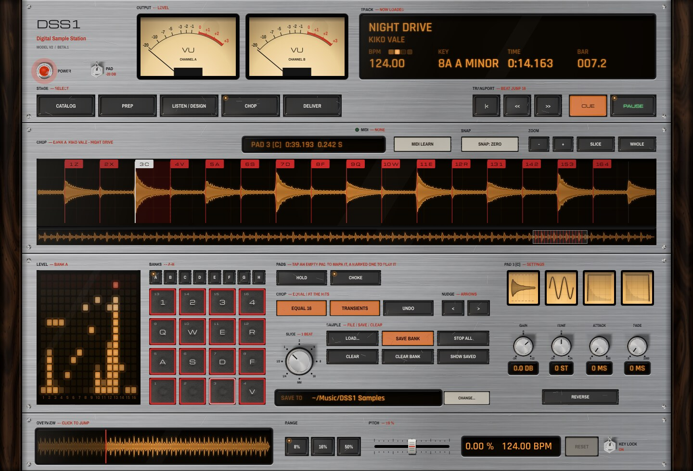
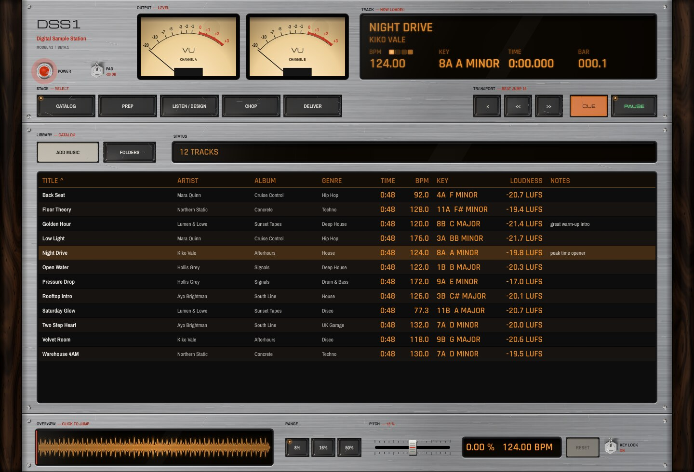
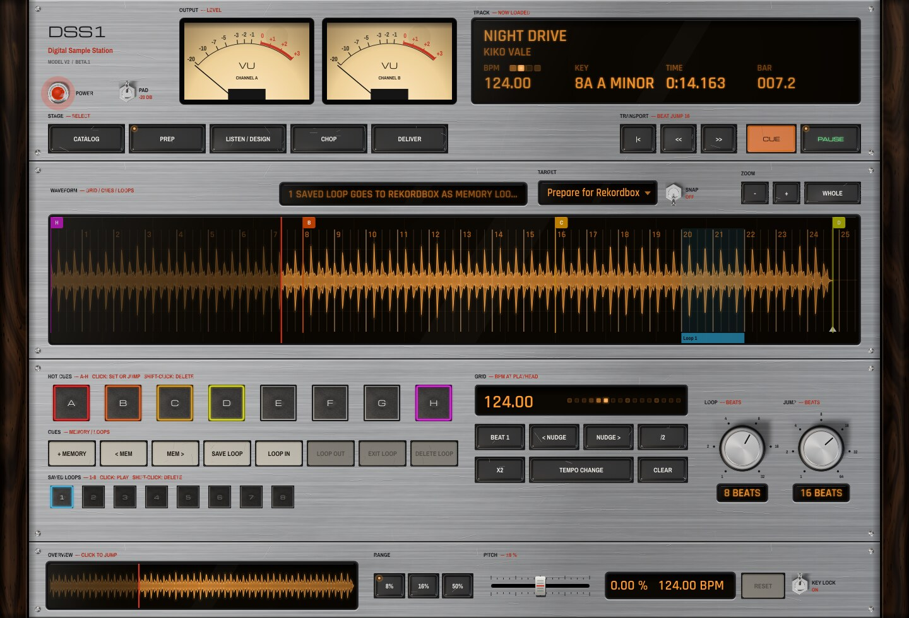
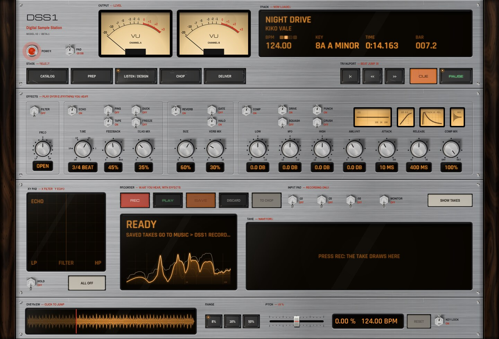
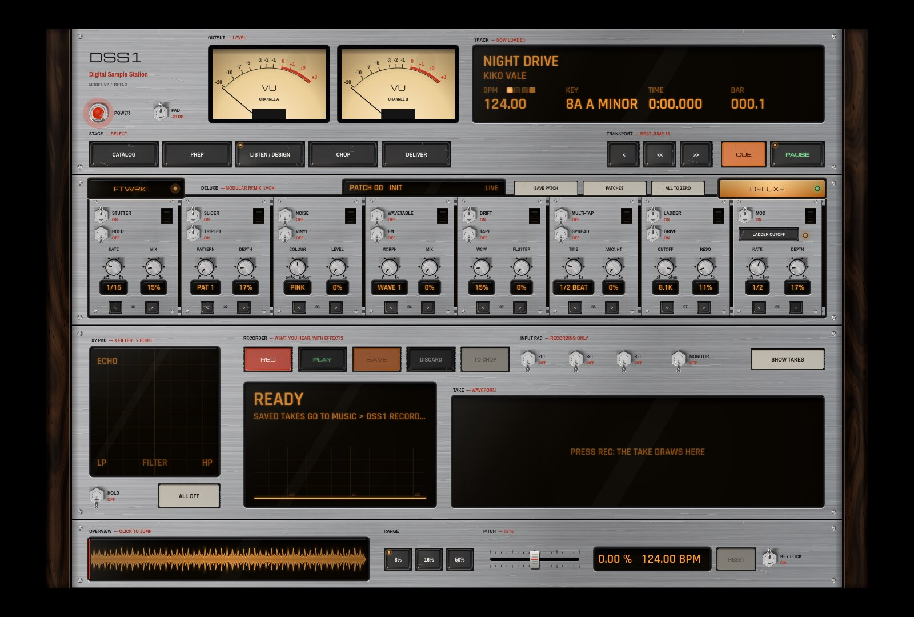
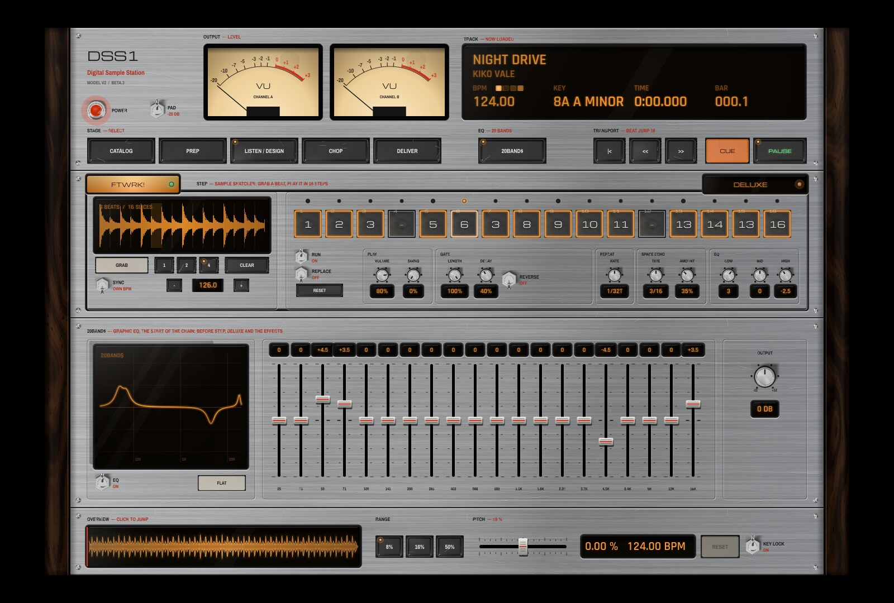
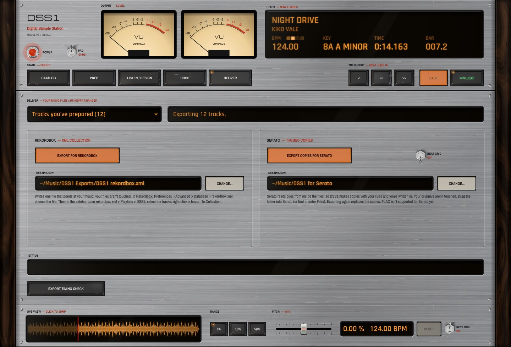

# DSS1 V2: Digital Sample Station

  

**Get your music ready for the show or the session.** Sort it, prep it, shape it, chop it, and deliver it to
Rekordbox, Serato or your MPC, in one app built like a 60s–80s hi-fi with displays from now.

### [Download the V2.1 beta](https://github.com/DarrenAlexanderCole/DSS1/releases/latest)

macOS 13 or later, Apple Silicon and Intel. The release also has the **[Beta Guide (PDF)](https://github.com/DarrenAlexanderCole/DSS1/raw/v2/docs/DSS1-V2-Beta-Guide.pdf)**
and a short [slideshow video](https://github.com/DarrenAlexanderCole/DSS1/raw/v2/docs/media/DSS1-V2-Beta-Slides.mp4).
Your music files are never changed: DSS1 only ever writes copies.



## Five screens

**Catalog: your music, sorted.** Drop in files, folders or record-pool zips. BPM, key, loudness and the beat grid
are worked out for you, and you can keep your own notes on every track.



**Prep: cues, loops and the grid.** Hot cues A–H, memory cues and saved loops on a zoomable waveform. Loops
resize live, and the grid tools handle downbeats, half/double tempo and tracks that drift.



**Listen / Design: shape the sound.** Filter, echo (PING, TAPE, DUCK, FREEZE), reverb (GATE, HALO) and an opto
compressor with EQ (DRIVE, PUNCH, SQUASH, CRUSH), with backlit monitors. Record what you hear and send it
straight to Chop.



**New in 2.1: DELUXE, a modular remix rack.** One press flips the effects into a case of eight modules: STUTTER,
SLICER, NOISE, WAVETABLE, DRIFT, MULTI-TAP, LADDER and MOD (an LFO that moves any module's knob in time with the
music). Everything starts turned down. Reorder the chain by dragging a module's grip, and save patches.



**New in 2.1: FTWRK!, the sample snatcher.** GRAB 1, 2 or 4 beats of what's playing, then play the slices from a
16-step sequencer in time with the track, with its own gate, note repeat and space echo.



**Chop: slice anything onto 128 pads.** Eight banks of 16. Tap an empty pad to mark a slice, tap it again to
play it. Each pad has gain, tune, attack, fade and reverse, and it all plays from the keyboard or a MIDI pad
controller (Akai MPC, MPD, MPK). Banks save as WAVs.

**Deliver: send it to your setup.** One Rekordbox XML with cues, loops, grids and notes, or tagged copies for
Serato with your cues and loops inside.



## Install

1. Download the `.dmg` from the [latest release](https://github.com/DarrenAlexanderCole/DSS1/releases/latest) and open it.
2. Drag **DSS1** onto **Applications**.
3. The beta isn't notarised by Apple yet, so the first time you open it: on **macOS 15+**, open **System Settings →
   Privacy & Security** and click **Open Anyway**; on **macOS 13–14**, right-click DSS1 and choose **Open**.

Found a problem or have an idea? [Open an issue](https://github.com/DarrenAlexanderCole/DSS1/issues), ideally with a screenshot.

**Looking for DSS1 1.5?** It's still available: [DSS1 1.5 (Beta)](https://github.com/DarrenAlexanderCole/DSS1/releases/tag/v1.5),
with its code on the [`v1` branch](https://github.com/DarrenAlexanderCole/DSS1/tree/v1). Both install as
"DSS1", so rename 1.5 first if you want to keep both.

---

## For developers

DSS1 V2 is built from scratch in C++20 on [JUCE](https://juce.com), so a Windows version can follow from the same
code. You need macOS 13 or later, the Xcode command line tools and CMake 3.24+ (`brew install cmake`).

```sh
cmake -S . -B build -DCMAKE_BUILD_TYPE=Release
cmake --build build --parallel
ctest --test-dir build --output-on-failure      # run the tests
open build/src/app/DSS1_artefacts/Release/DSS1.app
```

The first configure downloads JUCE and the other libraries (Catch2, nlohmann/json, pugixml, dr_libs, minimp3,
Signalsmith Stretch), so it takes a few minutes.

- Every push to `v2` is built and tested on GitHub Actions.
- Pushing to `test-build` publishes a numbered pre-release (`v2.1.0-test.<n>`) with [docs/TEST-BUILD.md](docs/TEST-BUILD.md).
- Running **Release (macOS)** by hand with a label (e.g. `beta.2`) publishes `v2.1.0-<label>` as the latest
  release with [docs/BETA.md](docs/BETA.md); **Release extras** then attaches the guide and media.

```
src/core/    Track data, beat grids, file formats, analysis: plain C++20, no UI or audio, fully unit-tested
src/io/      Audio decoding and tag reading
src/engine/  Decks with key lock, effects, sampler (no JUCE; rendered offline in tests)
src/app/     The JUCE desktop app
tests/       Unit tests (Catch2)
tools/       Blender part renders, textures, the app icon, the beta guide and slides
docs/        Architecture notes, release notes, screenshots
```

See [docs/ARCHITECTURE.md](docs/ARCHITECTURE.md) for the design. Ideas, bug reports and pull requests are welcome;
open an issue first for anything large.

## License

DSS1 V2 is free software under the [GNU Affero General Public License v3.0](LICENSE). It uses JUCE under the AGPLv3.
