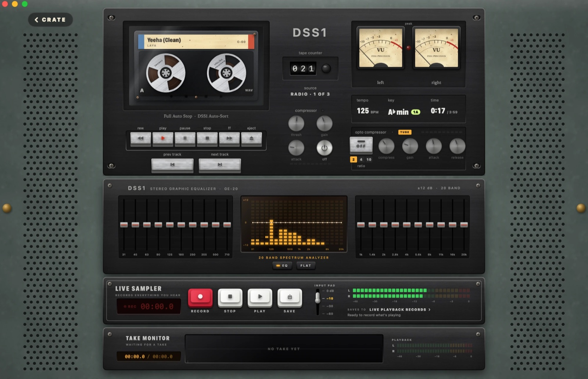
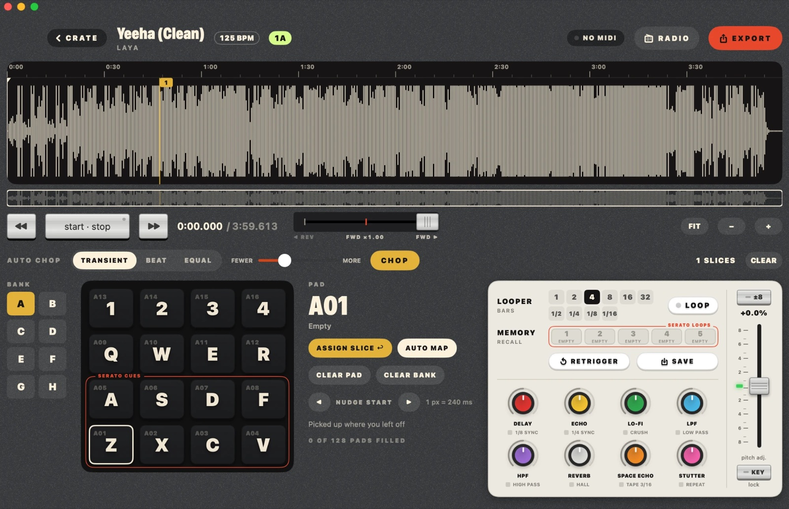
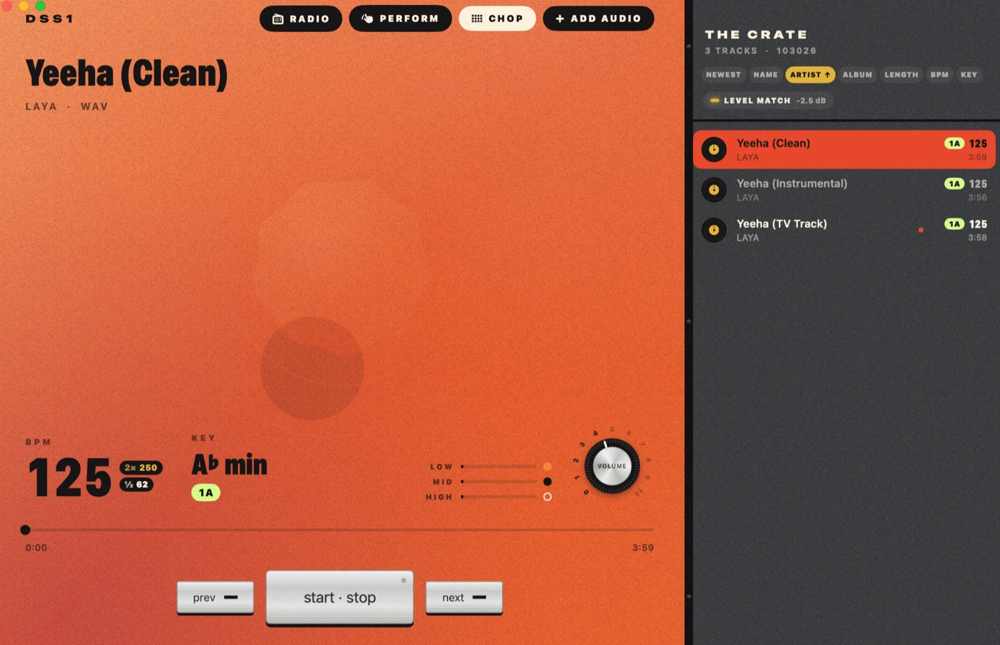
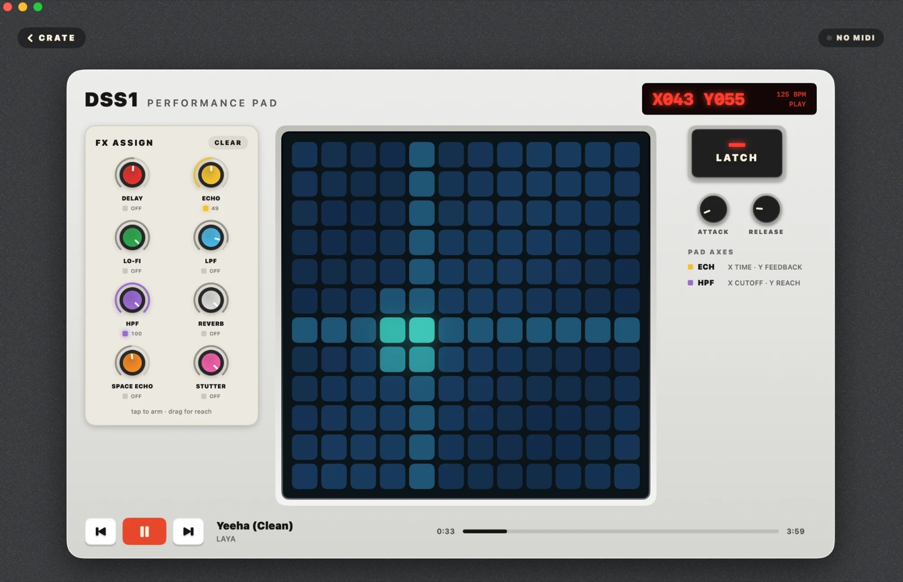
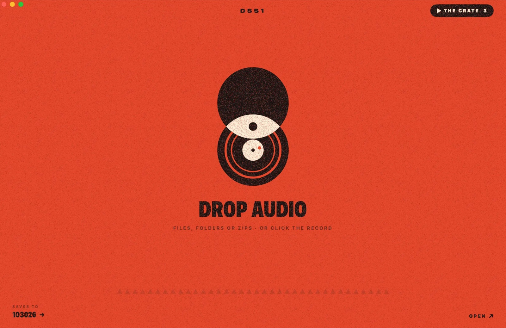

# DSS1 — Digital Sample Station 1

**A place to get your music ready before the show or the session.**

DSS1 is a Digital Sample Station: one macOS app where DJs and producers take the files they've just downloaded and
turn them into things they can play. You drop the music in, hear it on a tape-style deck, chop it up on pads, and
send the result to the tools you already use: Serato DJ for the set, or an MPC for the beat.

## Screenshots



**The Radio.** Tape deck with VU meters, both compressors, a 20-band EQ with spectrum analyzer, and the Live Sampler.



**Chop.** Pads 1–8 (outlined red) export to Serato as hot cues; the loop memories (outlined red) export as saved loops.



**The Crate.** Sort by BPM, key, artist and more; the player shows tempo, key and EQ.



**Performance pad.** Assign effects, then play them with the XY pad. Attack and release shape how they fade in and out.



**Drop.** Files, folders or zips go straight into your crate.

## Who it's for

**DJs preparing a set.** Record-pool downloads arrive as zips and folders. DSS1 unpacks them, keeps just the audio,
and sorts the crate by BPM and Camelot key so you can plan the order. Audition a track on the deck with tempo and
key changes, find the parts you want, and put them on pads 1–8. Then **Export for Serato** writes those pads into
a copy of the song as hot cues, and your loop memories as saved loops. Load it in Serato and the cues are already
there: drops, breakdowns, vocal hits, loops, with nothing to set up at the booth.

**Producers sampling for a track.** Chop a song across 16 pads per bank, set loops from 1/16 bar up to 32 bars,
add effects, and play it like an instrument. **Export for MPC** sends the slices to an MPC project, so you can
carry the idea from your Mac into the hardware.

**Live sets and recorded takes.** The Radio rack has a **Live Sampler** that records everything you hear, with the
deck's EQ, compressors and effects included, to a WAV. Play a track through the Radio, ride the EQ and the opto
compressor, hit RECORD, and what you keep is your *performance*: a live mix, a transition, a jam. Takes save as WAV files into a
"Live Playback Records" folder in your crate (or anywhere you choose), ready to use like any other track. An input-pad lever (0, −10, −30, −60 dB) keeps
the meters off the red.

**Both.** The Performance pad and a USB controller (Akai MPD / MPK / MPC, or anything via MIDI Learn) let you
rehearse live moves before you play them for an audience.

## How it fits together

1. **Drop** your files in. DSS1 imports the audio into your crate.
2. **Listen and sort** in the Crate and on the Radio deck: BPM, key, tape-style transport and a tube-style compressor.
3. **Chop** the song into pads, loops and memories.
4. **Record it live** (optional): hit RECORD on the Radio's Live Sampler to capture a performance as a WAV.
5. **Export** to Serato DJ or to an MPC, or keep playing it on the Performance pad.

## What's inside

- **Drop** — drop audio files, folders or record-pool zips; DSS1 pulls out the audio (MP3, WAV, FLAC, AIFF,
  M4A) and files it in your crate, as WAV by default.
- **Crate** — your library, sortable by BPM and Camelot key, with album art.
- **Radio** — a tape deck with working transport (REW plays backwards, FF at 1.5x), tempo and key, VU meters,
  a 3-knob compressor and a CL 1B-style tube opto compressor, a 20-band graphic EQ with a spectrum analyzer, and a
  **Live Sampler** that records everything you hear (effects and EQ included) to a WAV take with a waveform monitor.
- **Chop** — 16 pads per bank, auto loops from 1/16 bar to 32 bars, five loop memories, pad FX, and exports:
  - **MPC** — an MPC project (`.xpj`) with your slices.
  - **Serato DJ** — a tagged copy of the song where pads 1–8 are hot cues and the loop memories are saved loops.
- **Performance** — an effects pad with latch, attack and release.
- **MIDI** — USB controllers work out of the box (Akai MPD / MPK / MPC); MIDI Learn on any control, MMC
  transport, and a MIDI Monitor window for seeing exactly what a controller sends.

## Download

Grab the latest `DSS1-x.y.dmg` from [Releases](../../releases), open it and drag DSS1 to Applications.

The app isn't notarized by Apple, so the first time macOS will say it can't verify DSS1. Click **Done**, then go
to **System Settings → Privacy & Security**, scroll to "DSS1 was blocked…" and click **Open Anyway**.

Needs macOS 14 (Sonoma) or newer, on Apple Silicon or Intel.

Windows: there's no Windows version yet — see [docs/WINDOWS.md](docs/WINDOWS.md).

## Build from source

Needs Xcode or the Command Line Tools (Swift 5.9+).

```bash
./build.sh        # builds DSS1.app in this folder
./make_dmg.sh     # builds a universal DSS1.app and packages dist/DSS1-<version>.dmg
```

`./build.sh test` also compiles the `CRATE_*` test hooks used for automated checks; never ship that build.

The version number lives in `Resources/Info.plist`.

## Saving progress (for the maintainer)

```bash
git add -A
git commit -m "What changed"
git push
```

For a new version: bump `Resources/Info.plist`, add it to [CHANGELOG.md](CHANGELOG.md), run `./make_dmg.sh`,
then `git tag v1.6 && git push --tags && gh release create v1.6 dist/DSS1-1.6.dmg`.

## Credits

- [Rubber Band Library](https://breakfastquay.com/rubberband/) by Particular Programs Ltd — time-stretching and
  pitch-shifting (GPL v2 or later), in `Vendor/RubberBand`.
- [AudioKit](https://github.com/AudioKit/AudioKit) and SoundpipeAudioKit (MIT).
- Serato tag layout from the community documentation at
  [Holzhaus/serato-tags](https://github.com/Holzhaus/serato-tags). DSS1 isn't affiliated with Serato or Akai.

## License

GPL-3.0 — see [LICENSE](LICENSE). Because DSS1 includes Rubber Band (GPL), the app as a whole is GPL too.
